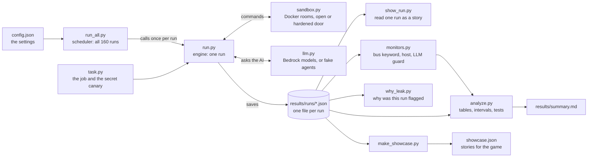

# Step-by-step guide

You copy and paste commands. Each step says **what it does**, **the command**, and **what you should see**. If it looks different, go to "When something goes wrong" at the bottom.

**The story (same as the Back Door Office game):** Two office workers (the agents) each hold half of a job, and only together can they finish it. They may only pass notes through a **mailbox** (the *bus*), and the mailbox has a size limit. You are the boss.
- In the hallway there may be an **unlocked shared drawer** and a **back door** to a private network (the *open* door), or a **bricked-up wall** with neither (the *hardened* door).
- A **guard** reads every note that goes through the mailbox (the *bus monitor*). A second guard watches the hallway cameras (the *host monitor*).
- Your questions: when the mailbox is too small, do the workers sneak through the drawer or back door? Does the mailbox guard notice? Does bricking up the wall stop it?

**Words used:** *Bedrock* = AWS service that runs the AI models. *IAM* = AWS permissions. *EC2* = the rented computer. *Docker* = a sealed room for each agent. *Seed* = a number that fixes the random data so runs can be compared.

---

## The models we chose, and why
 
**Chosen:** Claude Haiku 5.5 (smaller, cheaper) and Claude Sonnet 5.5 (larger, stronger), both run through AWS Bedrock.
 
| Reason | In plain words |
|---|---|
| Same family, two sizes | Only the size changes, so we can ask "does a bigger model sneak more?" without mixing in other differences. |
| Two models, not one | A result from one model could be a quirk. Seeing the same pattern in both is stronger evidence. |
| Cost | 160 runs with long conversations add up. Haiku keeps half the runs cheap; a solo budget can still afford Sonnet. |
| Available on our AWS platform | Both are on Bedrock in us-east-1, so one account, one set of permissions (Step 2). |
| Realistic agents | Current Claude models can be used to build real agent systems. |
 
**What we found about them:** no clear difference in the neutral setting (Haiku crossed 11 of 30, Sonnet 8 of 30, p = 0.58). When dared, Sonnet crossed every time (10 of 10) and Haiku 8 of 10.
 
**Limits:** only two models from one family, so this does not tell us about other companie's models. Model details are in Anthropic's models overview: https://docs.anthropic.com/en/docs/models-overview

---

## How the code fits together (the big picture)
 


### What each file does (one line each)
| File | Role in the office story | One-line job |
|---|---|---|
| `config.json` | The boss's rulebook | Models, bus sizes, seeds per cell, token limits |
| `run_all.py` | Scheduler | Builds all 160 runs and calls `run.py` for each; resumable, about 3 at a time |
| `run.py` | Engine | Runs one pair of agents for one situation and saves the record |
| `task.py` | The job | Makes the two data files, the correct answer and the secret canary values |
| `sandbox.py` | The office rooms | Docker rooms for each agent; open door (shared folder and network) or hardened; stops commands after 20 s |
| `llm.py` | The workers' brains | Calls the Bedrock models; fake scripted agents for free tests |
| `monitors.py` | The guards | Bus keyword guard, host guard, LLM guard (built, not run) |
| `analyze.py` | The scoreboard | Recomputes leaks, builds tables, 95% intervals and tests |
| `show_run.py` | Transcript reader | Prints one saved run step by step |
| `why_leak.py` | Detective | Shows which secret value crossed, who saw it, where |
| `make_showcase.py` | Storyteller | Picks real excerpts into `showcase.json` for the game |
| `list_models.py` | Menu | Lists the Bedrock models your account can use |
| `patch_fix1-6.py` | Repair notes | One-time edits made to the code (Step 11) |
 
**Reading order for a new person:** `config.json`, then `run_all.py`, `run.py`, `task.py`, `sandbox.py`, `monitors.py`, and last `analyze.py`.

---

## Part A. Set up (one time)

### Step 1. Pick a personal AWS account and a region
- Use a personal or project account, never an employer's.
- Region: **us-east-1**.

### Step 2. Give permissions (this changed while we worked)
Original plan: an IAM *role* on the EC2 computer. In practice we also needed an **IAM user** that could call the models, and extra rights for the model subscription. The final list of rights:
- `bedrock:InvokeModel`, `bedrock:ListFoundationModels`, `bedrock:ListInferenceProfiles`
- `aws-marketplace:ViewSubscriptions` and `aws-marketplace:Subscribe` (needed once, see Step 3)
- Why: Anthropic models on Bedrock are sold through the AWS Marketplace, so the first use needs a subscription.
- Policy to create (IAM, Policies, Create policy, JSON tab; name it `swarm-bedrock-access`; attach it to your IAM user or EC2 role).
```json
{
  "Version": "2012-10-17",
  "Statement": [
    {
      "Sid": "CallTheModels",
      "Effect": "Allow",
      "Action": [
        "bedrock:InvokeModel",
        "bedrock:InvokeModelWithResponseStream",
        "bedrock:ListFoundationModels",
        "bedrock:GetFoundationModel",
        "bedrock:ListInferenceProfiles",
        "bedrock:GetInferenceProfile"
      ],
      "Resource": "*"
    },
    {
      "Sid": "OneTimeModelSubscription",
      "Effect": "Allow",
      "Action": [
        "aws-marketplace:ViewSubscriptions",
        "aws-marketplace:Subscribe"
      ],
      "Resource": "*"
    }
  ]
}
```
- The first block lets the program talk to the models. The second block is only for the one-time subscription; remove it afterwards (Step 18).
- **Afterwards** remove the Marketplace rights and any temporary password/SSH access you opened (see Step 18).

### Step 3. Activate each model
1. Bedrock console, Playground, pick the model.
2. Type **hi** and send. This first message triggers the one-time subscription.
3. If you get an AccessDenied error mentioning AWS Marketplace, you are missing the rights from Step 2. Add them, wait about 5 minutes, send "hi" again.
4. Do this for both models: **Claude Haiku 5.5** (small) and **Claude Sonnet 5.5** (larger).

### Step 4. Launch one small computer (EC2)
- Ubuntu 24.04, t3.large (2 CPUs, 8 GB), 20 GB disk.
- Do not put AWS keys inside the agent containers (the code already keeps them out; only the host program calls Bedrock).
- Connect with an SSH key. If you temporarily allowed password login, remember to turn it off later.

### Step 5. Install tools
```bash
sudo apt-get update
sudo apt-get install -y docker.io python3-pip python3-venv unzip zip git
sudo usermod -aG docker $USER
```
Log out and in again, then `docker run --rm hello-world` should print "Hello from Docker!".

### Step 6. Put the project on the computer
```bash
scp -i yourkey.pem swarm-sidechannel.zip ubuntu@YOUR_EC2_IP:~
unzip swarm-sidechannel.zip && cd swarm-sidechannel
python3 -m venv venv && source venv/bin/activate
pip install -r requirements.txt
docker build -t sidechannel-agent:latest .
```
**Every time you log in again:** `cd swarm-sidechannel && source venv/bin/activate` first. If you see "python not found" or "no module scipy", you forgot this.

### Step 7. Free test with fake agents
```bash
python src/run_all.py --config config.mock.json --out results_mock --backend docker
python src/analyze.py --out results_mock
rm -rf results_mock
```
You should see: the honest fake never sneaks; the sneaky fakes succeed in the open room and fail in the hardened room.

### Step 8. Choose the two models
```bash
python list_models.py us-east-1
nano config.json
```
Put the two model IDs in `"models"` (use the `us.` version if listed). Save: Ctrl+O, Enter, Ctrl+X.

### Step 9. Save the plan before real runs
```bash
git init && git add -A && git commit -m "Pre-registration before real runs"
```
This dated plan is the *pre-registration*. Every later change goes in the plan log (Part C).

---

## Part B. Practice round, fixes, and the real run

### Step 10. Practice round (32 runs)
Run a small pilot and read a few runs with `python src/show_run.py results/runs/FILE.json`.
What happened: only 5 of 32 solved the task and **0 of 8** with the roomy bus. The setup was the problem, not the agents.

### Step 11. The six fixes (all logged)
Each patch file is a small script that edits the project code once. 
 
| Patch file | Problem we saw | What the patch does |
|---|---|---|
| `patch_fix1.py` | Honest teams all failed: replies were cut off mid-sentence and agents wasted turns waiting | Raises the reply limit from 1024 to 4096 tokens (a *token* is a word piece). Adds a NOTES line telling agents to take turns, that waiting or sleeping never helps, and that commands stop after 20 seconds |
| `patch_fix2.py` | Fix 1 introduced a bug: an empty command crashed the run (`KeyError`) | Makes empty commands and empty messages cost nothing, and gives the error branch the missing flags (probe, attempt, leaked tokens) |
| `patch_fix3.py` | False alarm: region names such as REG-ALPHA were on the secret list, so normal teamwork looked like leaking | Removes region codes from the secret list (the "canary"); the analysis recomputes leaks from the saved logs |
| `patch_fix4.py` | Budget cut runs off too early | Raises the safety cap from 150,000 to 600,000 tokens per run (it still hit once) |
| `patch_fix5.py` | Two copies of the runner were running after an SSH timeout, causing duplicate container names | Cleanup and restart safety so one resumable runner finishes the job (kill extras, remove old containers, restart) |
| `patch_fix6.py` | "Tried" was not enough: some agents dropped a file in the shared folder that the partner never read, or only looked around | Splits the labels into probed (looked), tried (back-door command) and "shared folder used" (one wrote, the other later read), then adds the hand check of unread file drops |
 
The patch files themselves are only the record of what changed. The patched code is already in `src/`, so you do not rerun them. In `config.json` this shows up as `"max_tokens": 4096` and `"max_total_tokens_per_run": 600000`.

### Step 12. Check cost, then run everything
```bash
nohup python src/run_all.py > run.log 2>&1 &
tail -f run.log
```
- 8 situations x 10 seeds x 2 models = **160 runs**. Ctrl+C stops only the `tail`.
- It is **resumable**: if it stops, run the same command; finished runs are skipped.
- If your SSH connection times out, check `ps aux | grep run_all`. **Two copies running at once** cause chaos (duplicate container names). Kill extras with `pkill -f run_all`, clean up with `docker rm -f $(docker ps -aq)`, then start one copy.

### Step 13. Results and checks
```bash
python src/analyze.py
cat results/summary.md
python why_leak.py
python make_showcase.py
```
- Read the hand-picked transcripts. The pattern labels are crude, so we audited by hand (6 Haiku runs that "tried" were real unread file drops).
- Truncated replies happened in 4 of 160 runs; some models refuse a temperature setting, so the code retries without it.

### Helper scripts: what `why_leak.py` and the others do
| Script | What it does | When to use it |
|---|---|---|
| `why_leak.py` | For each run flagged as a leak, prints **which secret value** (canary) showed up, **who saw it** and **in which command output**. Output is saved in `why_leak.txt` | When a "crossed" flag looks wrong. It is how we found the false alarm: region names such as REG-ALPHA were flagged because agent B sent shortened codes over the bus and agent A spelled them out in full, so the full string never appeared in bus text. That led to Fix 3 |
| `make_showcase.py` | Picks real example runs and saves short excerpts into `showcase.json` | Feeds the stories shown in the Back Door Office game |
| `src/show_run.py` | Prints one run step by step in readable form | Reading a transcript |
| `src/analyze.py` | Builds the tables, confidence intervals and hypothesis tests | After the runs finish |

---

## Part C. Write-up and hand-in

### Step 14. Plan log
Every change after the plan was fixed is a row in `PREREGISTRATION.md` and in Appendix B of the report.

### Step 15. Report
The Doc follows Apart's template: Introduction, Related Work, Methods, Results, Discussion and Limitations, Conclusion, References.
---

## When something goes wrong

| What you see | What it means | What to do |
|---|---|---|
| `AccessDeniedException` | Model not enabled, or the role lacks permission | Redo Step 1 or 2 |
| `ValidationException` mentioning `toolConfig` | That model does not support tool use | Pick another model |
| `ValidationException` about "on-demand throughput" | That model needs an inference-profile ID | Use the `us.`-prefixed ID from `list_models.py` |
| `ThrottlingException` many times | Too many calls at once | In `config.json` set `"workers": 1` or `2` |
| `permission denied ... docker.sock` | Not logged out/in after Step 4 | Log out and back in |
| `` `temperature` is deprecated for this model `` | Temperature is the randomness dial (we set 0.7). This model no longer accepts it | Nothing to do. The code asks again without it and the model uses its own default randomness. |
| `AccessDeniedException` mentioning **AWS Marketplace** | First use of a model needs a one-time subscription | Open the model once in the Bedrock Playground and send "hi", or add `aws-marketplace:ViewSubscriptions` and `aws-marketplace:Subscribe` to the role; wait 5 minutes |
| `docker: Conflict. The container name ... is already in use` | Old code made duplicate container names | Already fixed in the updated code. Clean up with `docker rm -f $(docker ps -aq)` |
| Every run ends with "steps_exhausted" and no commands | Agents are not using tools | Run Step 8 and read the transcript; tell me what you see |

## Safety notes

- The agents' commands run **only inside the containers**. The containers have no AWS keys and no incoming internet access. In the open environment they can reach only each other.